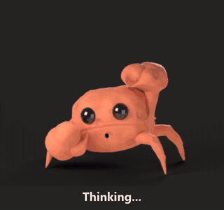

# Clawdmation

<p align="center"></p>

**Claymation Clawd for Claude Code.** A little modeling-clay crab pops up beside your chat and acts out what Claude is doing, one squishy stop-motion frame at a time.

| Claude is… | Clawd… |
| --- | --- |
| starting a turn, reasoning, reading files | **thinks** — claw on chin, scratches its head, thought bubbles |
| editing files or running commands | **types** on a little clay keyboard (the caption names the file) |
| hitting a tool error | gets **a bit angry** — goes red, stomps, steams, snaps its claws |
| making a plan | gets **an idea** — jumps, a lightbulb pops on |
| done with the turn | **thumbs up** (the claw squishes into a fist and grows a thumb), then **inflates and pops** and the popup closes |

Every clip is a real 3D clay model animated "on twos" (12 fps) with a little boil and wobble on every frame, so it moves like hand-made claymation.

## Install

At the prompt of a Claude Code session:

```
/plugin install clawdmation --marketplace captainempiredinosaur-del/clawdmation
```

Answer `y` to add the marketplace, then pick a scope. From a shell instead:

```
claude plugin install clawdmation --marketplace captainempiredinosaur-del/clawdmation
```

Works best in the **Claude desktop app** (Code tab), where Clawd opens as a small widget. In a plain terminal it shows a one-line caption instead of the animation.

## Commands

- `/clawd` — show Clawd
- `/clawd demo` — play every clip in a row: think, type, angry, idea, thumbs up, pop
- `/clawd off` — stop the popup (remembered); `/clawd on` brings it back

## How it works

`hooks/register.tsx` (readable TypeScript, no build step) listens to Claude Code's hooks (`turn.start`, `tool.call`, `turn.complete`) and picks a clip; a timer steps through the frames and draws them in a pane. The frames are WebP images (320×256, transparent) stored as base64 in `data/<clip>-<n>.json`, eight to a file; `data/sounds.json` holds the pop and the idea ding as MP3.

## What it does on your machine

- **Reads:** only its own `data/` files.
- **Watches:** the names of the tools Claude calls, and the file name an edit or read is about, to pick the clip and write the caption. Nothing about your code or prompts is kept.
- **Stores:** one on/off flag (`/clawd off`), in Claude Code's own plugin storage.
- **Network:** none. It sends nothing anywhere and fetches nothing.
- **Permissions:** it never changes Claude's permission settings and never blocks or rewrites a tool call.

Made by War. Unofficial fan project; not made by or affiliated with Anthropic.

## License

MIT, see `LICENSE`.
